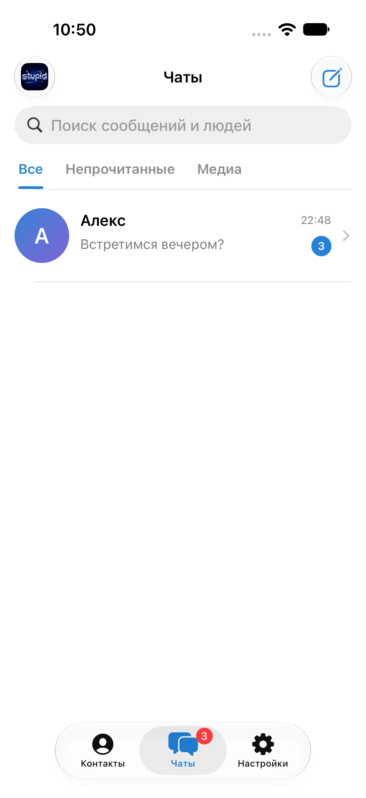
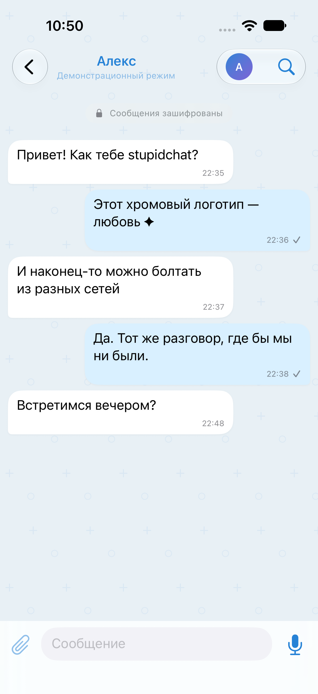

# stupidchat · iPhone messenger


<p align="center"></p>

**RU:** Мессенджер на SwiftUI со знакомой структурой Telegram: список чатов, поиск, архив, непрочитанные, вкладки контактов и настроек, отдельная переписка с голубыми пузырьками. Собственный бренд **stupidchat** и хромированная иконка **stupid** в стиле Y2K. Приложение не связано с Telegram и не использует его API.

**EN:** A native SwiftUI messenger with Telegram-inspired navigation, searchable chats, an archive, unread badges, contact profiles and blue message bubbles. Includes a custom chrome Y2K **stupid** app icon. Independent project; no Telegram API or affiliation.

## Quick start / Быстрый запуск

```sh
python3 server/server.py
open iOS/StupidChat.xcodeproj
```

For the simulator, the default endpoint is `http://localhost:8787`. For real phones outside your network, deploy the relay with HTTPS and enter the same server address and private relay key on both phones in **Настройки → Подключение и приглашения**. The key is stored inside the encrypted local history.

Чтобы добавить локальную конфигурацию сборки, скопируйте `iOS/Tiho/Connection.example.plist` в `iOS/Tiho/Connection.local.plist` и укажите свой адрес и ключ. Локальный файл не отслеживается Git и копируется в приложение только при наличии. Клон репозитория собирается без него; настройки можно ввести в интерфейсе.

Bundle ID и Keychain service сохранены от ранней версии для обновления без потери истории. Название на домашнем экране — **stupidchat**. Внутренний каталог `iOS/Tiho` оставлен ради совместимости конфигурации сервера.

## UI previews / Демонстрация интерфейса

Скриншоты ниже содержат только демонстрационные данные из Debug-режима `--ui-preview`. Он не читает реальную историю, не сохраняет данные и не обращается к сети. В Release этот режим отключён.

 

Светлая и тёмная темы следуют системной настройке iPhone. Галочка у исходящего означает принятие сервером, а не прочтение собеседником.

Нативный SwiftUI-проект для iOS 17+ и Xcode. Два iPhone могут использовать разные Wi-Fi-сети или мобильный интернет: оба подключаются к одному публичному HTTPS-адресу. Реализованы текст, фото, видео, голосовые, профиль, GIF-аватарка и баннер.

**Текущее развёртывание временное:** сервер работает на этом Mac, доступ из интернета — через SSH/HTTPS-туннель localhost.run. Mac должен оставаться включённым, с открытой крышкой и доступом в интернет. Отдельный облачный сервер не создан. Туннель может отключиться или сменить адрес; это не production-хостинг с гарантией доступности. Подключение в любой конкретной стране/сети зависит от доступности сервиса у оператора.

## Начать переписку

1. Откройте `iOS/StupidChat.xcodeproj`, выберите свою Team в Signing & Capabilities. Подключите iPhone, выберите его и нажмите Run. Повторите на втором iPhone. Если Xcode требует — включите Developer Mode на телефоне. Срок действия подписи зависит от Apple developer account.
2. На обоих телефонах нужна **обновлённая версия 0.3**, поскольку сервер теперь требует дополнительный ключ доступа. Для текущего сервера адрес и ключ находятся в локальном `iOS/Tiho/Connection.local.plist`, который исключён из Git. Не публикуйте этот файл: он содержит общий ключ доступа к вашей серверной установке. Этот ключ не расшифровывает сообщения.
3. Откройте настройки приложения. Текущий публичный адрес также записан в `server/connection.txt`. Старый адрес этого Mac обновляется при запуске новой сборки автоматически, с сохранением аккаунта, ключей, контакта и истории. Не удаляйте приложение для обновления.
4. Если собственного адреса ещё нет, нажмите «Подключиться и создать адрес».
5. Если контакт ещё не добавлен, обменяйтесь приглашениями через AirDrop или другой доверенный канал. Оба участника должны добавить код друг друга. Затем сверяйте весь код безопасности на двух iPhone лично или по доверенному голосовому каналу.
6. Отключите Wi-Fi на одном телефоне и используйте мобильную сеть для ручной проверки. Оба приложения должны быть открыты: push и фоновое получение пока не реализованы.

Если автоматическое обнаружение не настроено и адрес туннеля изменился, вставьте новый HTTPS-адрес в настройках **обоих** приложений и нажмите «Проверить и сохранить адрес». При существующем аккаунте приложение сначала проверяет доступ к тому же почтовому ящику на новом адресе. При ошибке старый адрес остаётся сохранённым. Новый адрес должен вести к той же серверной базе; перенос на пустой сервер не поддерживается.

При кратковременном обрыве связи получение повторяется автоматически, состояние отображается в шапке. Исходящие сообщения пока не имеют фоновой очереди: при ошибке отправки нужно повторить отправку вручную. Чувствительное содержимое по-прежнему шифруется на iPhone до обращения к сети.

## Автоматическое восстановление подключения · 0.3.1

Ранняя версия сохраняла адрес временного туннеля, который переставал работать после смены домена. Теперь приложение получает актуальный адрес из постоянного файла `relay.json` в отдельной ветке `relay-endpoint`, проверяет его Ed25519-подпись и при наличии аккаунта проверяет доступ к тому же почтовому ящику до смены адреса. История, ключи и аккаунт сохраняются.

В GitHub публикуются **только публичный адрес, время и цифровая подпись**. Ни сообщения, ни общий ключ API, ни приватные ключи туда не передаются. Закреплённый открытый ключ проверки и URL обнаружения находятся в локальной конфигурации сборки. Ветка адреса создана без исходников и workflow, поэтому смена адреса не запускает CI.

Проверка адреса выполняется при первом запросе и периодически, а после ошибки соединения — повторно. Если кеш raw.githubusercontent.com отстаёт, клиент получает тот же подписанный документ через GitHub Contents API; резерв используется при восстановлении, а не на каждом опросе сообщений. Параллельные запросы используют одну проверку адреса. Клиент отклоняет неправильную подпись, внешний HTTP, просроченный дескриптор и откат к более старому подписанному состоянию. GitHub и работающий Mac всё равно необходимы для обновления адреса; это восстановление транспорта, а не независимый облачный сервер.

Обновите **оба iPhone** до 0.3.1. В настройках подключения доступны «Автоматически находить сервер» и «Найти актуальный адрес». Если указать отдельный пользовательский сервер вручную, автоматический адрес отключается, чтобы приложение не подменяло выбранную установку.

## Запуск и остановка интернет-сервера

Нужны Python 3, OpenSSH, OpenSSL с Ed25519 и авторизованный GitHub CLI (`gh auth login`). Для публикации подписанного адреса:

```sh
python3 server/internet.py --runtime /absolute/path/to/tiho-runtime --discovery-repo owner/repository
```

Скрипт слушает `127.0.0.1:8787`, открывает HTTPS-туннель, сохраняет текущий адрес в `server/connection.txt`, обновляет локальный `Connection.local.plist` и публикует подписанное описание адреса. После обрыва SSH туннель подключается заново. Ошибки публикации повторяются отдельно и не останавливают сервер. Общий ключ API — `access.key`, приватный ключ подписи адреса — `discovery-private.pem`; оба находятся только в приватной runtime-папке.

Сохраните runtime-папку между запусками. Для смены приватного ключа подписи нужно обновить открытый ключ в обеих сборках. Во время работы `caffeinate` предотвращает обычный автоматический сон Mac; закрытие крышки, ручной сон, выключение или отсутствие интернета прерывают доступ.

Для автозапуска при входе пользователя и перезапуска после сбоя на Mac:

```sh
python3 server/install_macos_service.py --runtime /absolute/path/to/tiho-runtime --repo owner/repository
```

Установщик создаёт пользовательский LaunchAgent `app.stupidchat.relay`, заменяя только экземпляр этого же сервиса или известный процесс разработки. В текущей установке runtime находится в `work/internet` рабочей папки Codex. Сервис не требует прав администратора. Логи: `service.log`, `relay.log`, `tunnel.log` в runtime.

Остановка сервиса:

```sh
launchctl bootout gui/$(id -u)/app.stupidchat.relay
```

Чтобы убрать автозапуск, после остановки удалите `~/Library/LaunchAgents/app.stupidchat.relay.plist`. Ручной экземпляр сервера останавливается Ctrl+C. Не запускайте одновременно несколько экземпляров на одном порту.

## Как шифруется переписка

- X25519 → HKDF-SHA256 → ChaCha20-Poly1305 через Apple CryptoKit. Приглашения закрепляют публичные ключи. UUID пакета аутентифицирован как AAD; nonce генерирует CryptoKit.
- Текст, вложения и профиль зашифрованы вместе до отправки. Приватные ключи устройств серверу и туннельному сервису не передаются.
- Приватный ключ устройства и отдельный ключ локальной истории — в Keychain с `WhenUnlockedThisDeviceOnly`. История и токен очереди зашифрованы AES-GCM, записываются атомарно с полной файловой защитой; Documents исключён приложением из резервных копий.
- Сервер хранит ciphertext, случайные адреса, UUID, время поступления и хеши индивидуальных токенов. Туннельный провайдер завершает HTTPS и видит зашифрованные пакеты, транспортные токены и метаданные. Он не получает ключ содержимого. Это не система анонимизации.
- После сохранения истории получатель подтверждает приём, сервер удаляет пакет из рабочей SQLite-таблицы с `secure_delete`. Пакеты старше семи дней удаляются при следующем запросе. Физическое стирание SSD/снапшотов этим не гарантируется.
- Для API требуется общий ключ установки, для чтения/ACK/проверки аккаунта — также индивидуальный bearer-токен. Общий ключ встроен в клиент и извлекаем из него; это ограничение доступа к частной установке, а не самостоятельная гарантия от злонамеренного участника.
- Ограничения: 64 аккаунта, 100 пакетов на очередь, 256 МиБ суммарного ciphertext, 28 МиБ на запрос. Сервер слушает только loopback; наружу публикуется API через туннель. Серверные access logs отключены. Ограничения частоты и полноценная защита от DoS ещё не реализованы.

**Прототип не проходил аудит. Нет Double Ratchet, forward secrecy и post-compromise security.** При компрометации долговременного приватного ключа можно расшифровать ранее перехваченные пакеты. Для высоких требований к защите нужен проверенный протокол и независимый аудит.

## Медиа и профиль

Фото/видео — через плюс, микрофон начинает запись, повторное нажатие останавливает и отправляет её. Автоматическая остановка через 120 секунд; затем нажмите стоп для отправки. Вложения не сжимаются, до 18 МиБ, аватарка и баннер менее 2 МиБ каждый; полное сериализованное сообщение дополнительно ограничено 20 МиБ. Для крупных видео требуется предварительное сжатие. GIF сохраняется, если Photos возвращает исходный GIF; некоторые форматы медиатека преобразует.

Профиль доставляется внутри зашифрованного сообщения; отдельное обновление — кнопкой в настройках. Нажмите аватарку собеседника в шапке, чтобы увидеть его профиль и баннер.

## Постоянный сервер без Mac

Подготовлены `server/Dockerfile`, `compose.yml`, `Caddyfile`. Нужны ваш VPS, домен, Docker Compose и доступ к DNS. Эти файлы ещё не проверялись на реальном VPS. Для сохранения существующих аккаунтов необходимо перенести текущую SQLite-базу в volume `/data/relay.sqlite3`, общий ключ установки и использовать тот же протокол.

На VPS направьте домен на сервер, откройте TCP 80/443, задайте `TIHO_DOMAIN` и `TIHO_ACCESS_KEY` через приватный `.env` и из папки `server` выполните:

```sh
docker compose up -d --build
```

Порт 8787 наружу не публикуется; Caddy проксирует HTTPS. Обновите HTTPS-адрес в настройках обоих iPhone. Для публичного сервиса дополнительно нужны аудит, ограничения частоты, мониторинг и обслуживание.

## Проверки

`python3 server/test_relay.py`: авторизация очереди, общий ключ доступа, проверка существующего аккаунта, доставка, идемпотентность до ACK, удаление после ACK и отказ невалидному base64.

iOS `TihoTests/DeliveryTests.swift`: используется **реальный публичный HTTPS-адрес из локальной конфигурации**, два X25519-ключа и две очереди. Проверяются расшифровка второй стороной, text/photo/video/voice как полезные нагрузки, профиль, сохранение истории, ACK, изменение адреса, отказ внешнему HTTP и миграция старого адреса без потери истории. Тест временно заменяет историю тестового экземпляра и восстанавливает её после завершения. Не запускайте его на физическом устройстве с нужной перепиской.

Остаются отдельные ручные проверки: два физических iPhone на разных операторах, реальная запись и воспроизведение медиа. Push, несколько контактов, группы, звонки, резервное восстановление и фоновые исходящие пока отсутствуют.

Документация: [Apple CryptoKit](https://developer.apple.com/documentation/cryptokit), [Signal Double Ratchet](https://signal.org/docs/specifications/doubleratchet/), [localhost.run HTTPS-туннели](https://localhost.run/docs/http-tunnels), [временные домены](https://localhost.run/docs/faq).

## Development checks / Проверки разработки

- Server: `python3 server/test_relay.py`.
- UI: scheme `StupidChat`, target `StupidChatUITests`. Проверяет вкладки, открытие переписки, поиск и настройки на демонстрационных данных.
- Crypto/delivery: target `StupidChatTests`, живой сервер из локальной конфигурации. Для этого теста используйте отдельный симулятор.
- CI builds the simulator app without private connection settings and runs the relay tests.

The app icon was created with the built-in imagegen tool. The exact generation prompt is in [branding/PROMPT.md](branding/PROMPT.md).

Проверки восстановления: `DiscoveryTests` проверяет подпись, изменение полезной нагрузки, другой ключ, срок действия, откат времени и HTTP-адреса. `DeliveryTests` начинает с заведомо устаревшего адреса и проверяет получение актуального адреса, доставку и восстановление аккаунта с сохранённой историей.
